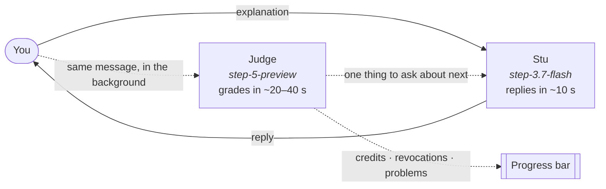

<div align="center">


# Teach Stu

### If you can teach it, you know it.

Stu is your new AI student: cheerful, curious, and a little dim. Bring your lecture notes and explain the ideas in your own words. Catch his mix-ups along the way. When he finally gets it, he teaches it back and quizzes you.

**[Try it at brodidnot.study →](https://www.brodidnot.study)**


</div>

---

## Why

Rereading notes feels like learning. Explaining them shows what you actually know. Teach Stu flips the usual AI tutor around: **the AI doesn't help you, you help the AI.** It catches the gaps in your understanding without ever handing you the answer.

## How it works

1. **Bring the material.** Upload text-based PDFs, paste notes, or choose **or just start talking** with only a topic title.
2. **Pick a depth, once.** *Big picture*, *Exam ready*, or *Expert*. It stays fixed for the topic, so the bar can't be moved.
3. **Teach Stu.** Explain one idea at a time. Stu reacts in his own words, asks one question, and sometimes states a planted mistake for you to catch.
4. **Watch one bar.** A hidden, pessimistic Judge grades every message against a private *cover → explain → connect* rubric. You only see overall progress, so you can't game it.
5. **Learn it back.** Once you've taught everything, Stu teaches the topic back from your verified wording and quizzes you, with citations to your notes.

## Two models, one student



| Role | Model | Job | Sees |
| --- | --- | --- | --- |
| **Planner** | `step-5-preview` | Turns your notes (or just the title) into a hidden rubric | Notes, title, depth |
| **Stu** | `step-3.7-flash` | The visible, deliberately dim student | Only the chat, plus one phrase of yours to ask about |
| **Judge** | `step-5-preview` | Grades every message in the background; every credit must quote your exact words, and the server re-checks each quote | Relevant notes, rubric, conversation |
| **Re-learn** | `step-5-preview` → `step-3.7-flash` | Writes a checked recap and quiz; Stu teaches it back | Your verified quotes, notes |
| **Voice** *(optional)* | `stepaudio-3-asr-max`, `stepaudio-3-tts` | Speak your explanation (you review the transcript first); hear Stu's replies | Your recording, Stu's text |

**Why the split?** StepFun's models think before they answer. Grading *and* writing Stu's reply in one Step 5 call took over 100 seconds. Now Stu answers on the faster model right away, while Step 5 grades in the background. Every request is streamed. Messages are graded in order, and a failed grading stays queued for the next one. The plan is built from two parallel Step 5 samples, and the first valid one wins. The **Step 5 Preview · Live** badge appears only after a grading that actually ran on `step-5-preview`.

## Honest by design

- **Stu never sees your notes or the rubric**, so he can't leak answers.
- **Credits require your own words.** A quote the model invents or rewords fails the server's check, as does "yes, exactly". A later contradiction takes credit back.
- **Sample sessions are labeled *Sample demo*** and use fixed responses, not a model.
- **No training.** Stu doesn't permanently learn from you. Notes and conversations stay in your browser (IndexedDB), and the rubric lives in an encrypted (AES-GCM) state token that the browser can't read.

## Run it locally

Requires Node.js 22.13+.

```sh
npm ci
cp .env.example .env   # add STEPFUN_API_KEY for live teaching
npm run dev            # http://127.0.0.1:5173 (API on :3001)
```

Without a key, **Try a sample session** still works end to end.

| Command | What it does |
| --- | --- |
| `npm run check` | Type-check |
| `npm test` | Server and library tests (mocked providers, no API credits) |
| `npm run test:e2e` | Playwright browser tests (needs `npm run dev` running) |
| `npm run build` | Production build |

## Deploy

Vercel Hobby serves the Vite frontend and runs the Express API as one same-origin function (`api/index.ts`, 180 s limit; see `vercel.json`). Set these in the Vercel project, never with a `VITE_` prefix:

| Variable | |
| --- | --- |
| `STEPFUN_API_KEY` | Required. Used by the Judge, Stu, and voice |
| `SESSION_SECRET` | Required. A long random value; keep it stable so saved sessions stay readable |
| `ENABLE_JUDGE_DEBUG` | Optional. `true` adds a **Show Judge Evidence** setting |
| `STEPFUN_{RUBRIC,JUDGE,BRIEF,STU}_REASONING_EFFORT` | Optional. Default `low` |
| `STEPFUN_{RUBRIC,JUDGE,BRIEF,STU}_TIMEOUT_MS` | Optional. Defaults 150 / 150 / 60 / 35 s |

DNS for `brodidnot.study` is in [docs/DOMAIN.md](docs/DOMAIN.md).

## Limits

Up to 5 files per topic, 20 MB and 100 pages per PDF, and 300,000 extracted characters in total. Recordings are capped at 3 minutes. Scanned PDFs need OCR, which isn't supported yet, so paste their text instead. Long notes are sampled evenly per page when the plan is built. The Judge still reads the full passages it needs.

## Under the hood

Vite + React 19 · Express · Zod · pdf.js · strict TypeScript · `node:test` · Playwright. State and evidence rules are in [server/README.md](server/README.md), and every architectural decision is in [docs/DECISIONS.md](docs/DECISIONS.md). Contributors start with [AGENTS.md](AGENTS.md).

## Team

Built for the AI LA Hackathon 2026 by [@ruxinsheng](https://github.com/ruxinsheng), [@jamlol123](https://github.com/jamlol123), [@zenoro0](https://github.com/zenoro0), and [@samerrahman](https://github.com/samerrahman)

