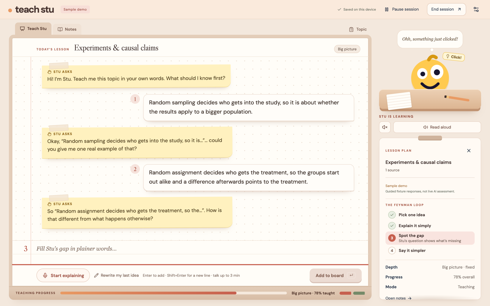
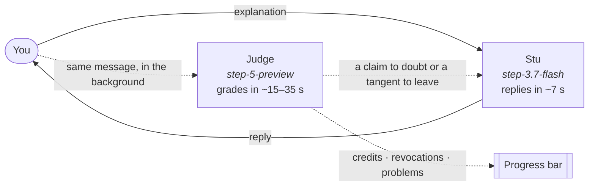

<div align="center">


# Teach Stu

### If you can teach it, you know it.

The Feynman technique, with a student who really needs you. Stu is cheerful, curious, and a little dim. Bring your lecture notes and explain them to him in plain words. He asks about the gaps, gets things wrong on purpose so you can catch him, and only "gets it" once you really do.

**[Try it at brodidnot.study →](https://www.brodidnot.study)**




</div>

---

## The Feynman technique

Richard Feynman, the physicist, was known for explaining hard ideas in plain language. The study method named after him has four steps:

1. **Pick one idea** you want to understand.
2. **Explain it simply**, as if to someone who has never heard of it.
3. **Find the gaps:** wherever your explanation stalls or goes vague, you don't understand it yet. Go back to the source.
4. **Simplify and retry** until the explanation is short, plain, and complete.

It works because explaining exposes what rereading hides. Doing it alone is hard, though. There's nobody to notice where you went vague, and nothing stops you from drifting onto what you already know. Teach Stu provides that missing beginner.

| Feynman step | What Teach Stu does |
| --- | --- |
| **1. Pick one idea** | You choose the notes and a depth (*Big picture*, *Exam ready*, or *Expert*). Stu knows the names of the lesson's ideas and asks about one at a time, starting with the first one you haven't taught yet. |
| **2. Explain it simply** | Stu is a true beginner. He learns only from your words and never sees your notes, so you have to explain each idea yourself. The first credit for each idea is earned by its plain-language gist, not by jargon. |
| **3. Find the gaps** | Stu asks one question at a time about the part you left vague, misstates details on purpose so you have to correct him, and says he's not sure when you get something wrong. Your notes stay one tab away whenever you need to go back to the source. |
| **4. Simplify and retry** | **Rewrite my last idea** puts your last explanation back on the board to make it plainer. When you've taught everything, Stu teaches it back from your own verified words and quizzes you. |

A hidden, pessimistic Judge grades every explanation against a private *gist → explain → connect* rubric. You see one progress bar, so the only way to move it is to explain the material better.

## Staying on the lesson

The technique only works if the conversation stays on what you're studying. Early versions of Stu followed every tangent: asked "what do plants do at night?", a photosynthesis lesson drifted into cellular respiration and never came back. Now:

- **Stu knows the lesson plan.** He gets the topic title, the names of its ideas (never the rubric or the notes), and the idea he most wants to learn next. The server picks that idea: either the one you're explaining right now, or the first one you haven't taught yet.
- **He steers back from tangents.** If your message wanders into a story or facts your notes don't cover, he says he's lost on how it fits and asks about the lesson again. He uses your examples to understand the idea they show, not to chase their details.
- **The server checks his questions.** Each reply races two samples. A sample that brings up a subject that appears nowhere in your notes, the lesson, or your own words loses to one that stays on topic.

Measured on a live evaluation in [`tests/evals/stu-on-topic`](tests/evals/stu-on-topic): 12 simulated lessons across 4 topics and 3 kinds of teacher (diligent, easily led, prone to wandering off), with every Stu reply graded blind:

| Every Stu reply, graded blind | Before | After |
| --- | --- | --- |
| Squarely on the notes | 68% | **89%** |
| Off the lesson entirely | 14% | **0%** |
| Stu brought up a tangent himself | 5% | **1%** |
| Steered back when the teacher wandered off | 3 of 34 | **19 of 23** |
| Lesson ideas reached in six turns | 63% | **75%** |
| Feynman quality of his question (0–2) | 1.18 | **1.55** |
| Sounds like Stu (short, one question) | 97% | **98%** |
| Replies that failed with an error | 4 of 72 | **1 of 72** |

The biggest change is with the teacher who wanders off: Stu's replies stayed on the notes 46% of the time before and 92% after. Replies are as fast as before (median 6.1 s, down from 6.4 s).

## Two models, one student



| Role | Model | Job | Sees |
| --- | --- | --- | --- |
| **Planner** | `step-5-preview` | Turns your notes (or just the title) into a hidden rubric | Notes, title, depth |
| **Stu** | `step-3.7-flash` | The visible, deliberately dim student | The chat, the lesson's title and idea names, and one thing to ask about |
| **Judge** | `step-5-preview` | Grades every message in the background; every credit must quote your exact words, and the server re-checks each quote | Relevant notes, rubric, conversation |
| **Re-learn** | `step-5-preview` → `step-3.7-flash` | Writes a checked recap and quiz; Stu teaches it back | Your verified quotes, notes |
| **Voice** *(optional)* | `stepaudio-3-asr-max`, `stepaudio-3-tts` | Speak your explanation (you review the transcript first); hear Stu's replies | Your recording, Stu's text |

**Why the split?** StepFun's models think before they answer. Grading *and* writing Stu's reply in one Step 5 call took over 100 seconds. Now Stu answers on the faster model right away, while Step 5 grades in the background. Every request is streamed, and messages are graded in order. The study plan is built from two parallel Step 5 samples, and the first valid one wins. The **Step 5 Preview · Live** badge appears only after a grading that actually ran on `step-5-preview`.

## Honest by design

- **Stu never sees your notes or the rubric.** He knows only the names of the lesson's ideas, the way a student knows the chapter headings, so he can't hand you the answers.
- **Credits require your own words.** A quote the model invents or rewords fails the server's check, as does "yes, exactly". A later contradiction takes credit back.
- **The Feynman loop beside the board is driven only by what you do** (writing, sending, waiting for Stu), never by the hidden grading.
- **Sample sessions are labeled *Sample demo*** and use fixed responses, not a model.
- **No training.** Stu doesn't permanently learn from you. Notes and conversations stay in your browser (IndexedDB), and the rubric lives in an encrypted (AES-GCM) state token that the browser can't read.

## Run it locally

Requires Node.js 22.13+.

```sh
npm ci
cp .env.example .env   # add STEPFUN_API_KEY for live teaching
npm run dev            # http://127.0.0.1:5173 (API on :3001)
```

Without a key, **Try a sample session** still works end to end.

| Command | What it does |
| --- | --- |
| `npm run check` | Type-check |
| `npm test` | Server and library tests (mocked providers, no API credits) |
| `npm run test:e2e` | Playwright browser tests (starts its own API on :3101 and web on :5174) |
| `npm run build` | Production build |
| `npx tsx tests/evals/stu-on-topic/run.mts --label <name>` | Live on-topic evaluation (uses real StepFun credits; see its README) |

## Deploy

Vercel Hobby serves the Vite frontend and runs the Express API as one same-origin function (`api/index.ts`, 180 s limit; see `vercel.json`). Set these in the Vercel project, never with a `VITE_` prefix:

| Variable | |
| --- | --- |
| `STEPFUN_API_KEY` | Required. Used by the Judge, Stu, and voice |
| `SESSION_SECRET` | Required. A long random value; keep it stable so saved sessions stay readable |
| `ENABLE_JUDGE_DEBUG` | Optional. `true` adds a **Show Judge Evidence** setting |
| `STEPFUN_{RUBRIC,JUDGE,BRIEF,STU}_REASONING_EFFORT` | Optional. Default `low` |
| `STEPFUN_{RUBRIC,JUDGE,BRIEF,STU}_TIMEOUT_MS` | Optional. Defaults 150 / 150 / 60 / 35 s |
| `STU_TOPIC_GUARD` | Optional. `off` disables the on-topic check on Stu's samples |

DNS for `brodidnot.study` is in [docs/DOMAIN.md](docs/DOMAIN.md).

## Limits

Up to 5 files per topic, 20 MB and 100 pages per PDF, and 300,000 extracted characters in total. Recordings are capped at 3 minutes. Scanned PDFs need OCR, which isn't supported yet, so paste their text instead. Long notes are sampled evenly per page when the plan is built. The Judge still reads the full passages it needs.

## Project layout

| Folder | What's in it |
| --- | --- |
| [`web/`](web) | The site: React app (`web/src`), static files (`web/public`), `index.html`, Vite config |
| [`server/`](server) | The Express API: the Judge, Stu, state sealing, voice |
| [`api/`](api) | The Vercel function that serves `server/` |
| [`shared/`](shared) | Types used by both the site and the server |
| [`tests/`](tests) | Playwright tests, their config, and the live on-topic eval in [`tests/evals`](tests/evals/stu-on-topic) |
| [`docs/`](docs) | Decisions, domain setup, screenshots, the original build handoff |

Unit tests sit next to the code they test (`server/*.test.ts`, `web/src/lib/*.test.ts`).

## Under the hood

Vite + React 19 · Express · Zod · pdf.js · strict TypeScript · `node:test` · Playwright. State and evidence rules are in [server/README.md](server/README.md), and every architectural decision is in [docs/DECISIONS.md](docs/DECISIONS.md). Contributors start with [AGENTS.md](AGENTS.md).

## Team

Built for the AI LA Hackathon 2026 by [@ruxinsheng](https://github.com/ruxinsheng), [@jamlol123](https://github.com/jamlol123), [@zenoro0](https://github.com/zenoro0), and [@samerrahman](https://github.com/samerrahman): Lucy's teaching engine, Lea's design, James's voice, and Samer's deployment and speed work.
